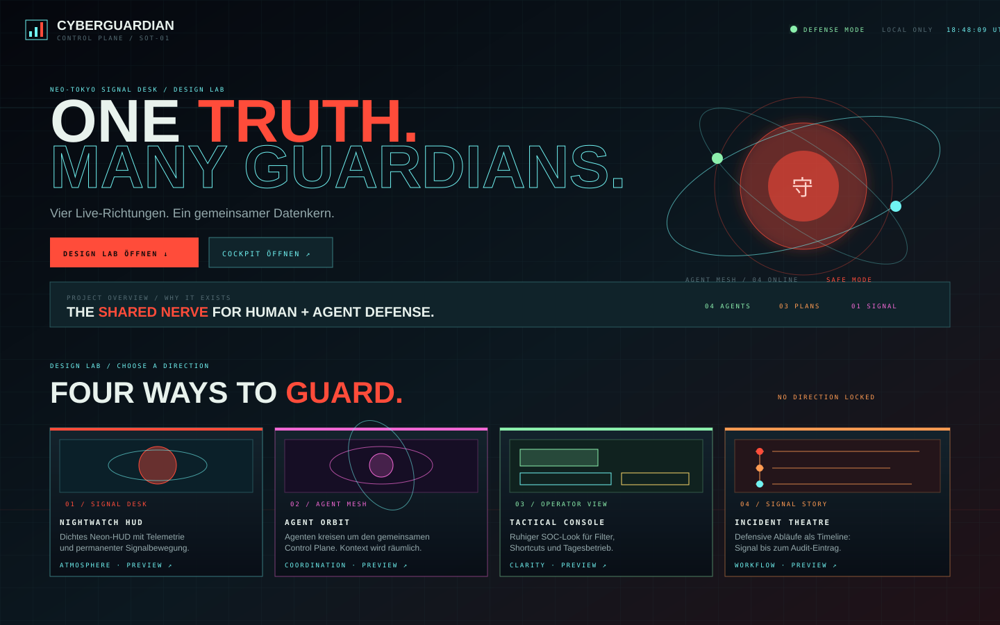
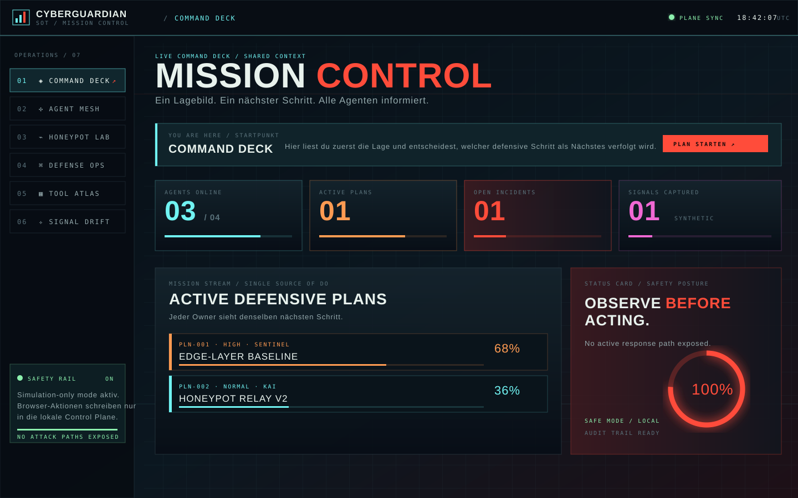
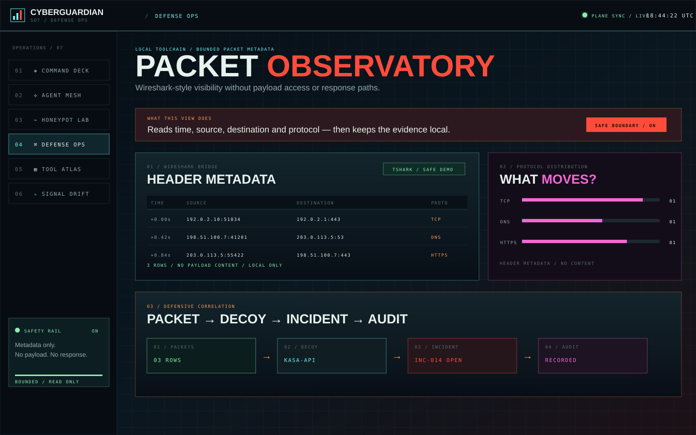

# CyberGuardian Pro

## Defensives Agenten-Leitpult · Single Source of Do · Honeypot-Simulation

CyberGuardian ist eine lokale, defensive Security-Suite für Menschen und spezialisierte Agenten. Sie bündelt Beobachtung, Planung, Deception, Beweissicherung, Recovery und Tooling in einem gemeinsamen Leitstand.

> **Projektseite:** <https://indieaner84.github.io/CyberGuardian/> · Die statische GitHub-Pages-Seite erklärt Mission, Architektur, Packet Observatory, Tool Atlas und Safety Scope.

## GitHub Pages veröffentlichen

Die statische Projektseite liegt in `docs/` und benötigt keinen Python-Server. In GitHub unter **Settings → Pages** als Quelle **Deploy from a branch** wählen, den Branch `arena/01a053ed-cyberguardian` (nach dem Merge alternativ `main`) und den Ordner `/docs` auswählen. Danach ist die Seite unter `https://indieaner84.github.io/CyberGuardian/` erreichbar.

Der zentrale **Control Plane** ist die **Single Source of Truth**: Eine Absicht wird einmal als Plan angelegt, von zuständigen Agenten übernommen, mit sicheren Beobachtungen angereichert und als nachvollziehbarer nächster Schritt an das Team verteilt. So bleibt sichtbar, wer was vorhat, warum es passiert, welcher Status gilt und was als Nächstes zu tun ist.

## Allgemeine Projektbeschreibung

CyberGuardian ist in drei Ebenen gedacht:

1. **Wahrnehmen** — lokale, read-only Sensorik und begrenzte Metadaten-Checks für Interfaces, Prozesse, Sockets, WLAN, VPN und Tool-Verfügbarkeit.
2. **Verstehen** — Agent Mesh, Handoffs, Prioritäten, Incidents und eine gemeinsame Aktivitätsspur verbinden einzelne Signale zu Kontext.
3. **Verantwortungsvoll handeln** — virtuelle Honeypot-Übungen, Beweiskette, Backups und explizite Safety Rails ersetzen unkontrollierte Gegenangriffe.

Der Browser ist eine verständliche Leitstelle, kein offener Remote-Shell-Runner. Die Oberfläche kann sichere, allowlistete Beobachtungsaktionen auslösen und deren Resultat auditieren. Produktive oder privilegierte Änderungen bleiben bewusst einem separat authentifizierten Operator-Workflow vorbehalten.

### Zielgruppe

CyberGuardian richtet sich an defensive Blue Teams, Security-Lern- und Forschungslabore, Betreiber kleiner autorisierter Testumgebungen sowie Entwickler von Agenten-Workflows. Es ist besonders nützlich, wenn mehrere Rollen dieselben Beobachtungen sehen müssen: Operatoren setzen Grenzen, Agenten korrelieren und übergeben Kontext, und Lernende können Abläufe mit virtuellen Honeypots nachvollziehen.

## App Preview

Die folgenden UI-Aufnahmen zeigen die wichtigsten Bereiche der aktuellen App. Sie sind als statische, repository-eigene SVG-Previews abgelegt und funktionieren direkt auf GitHub ohne externe Bild- oder Font-Abhängigkeiten.

<p align="center"></p>

<p align="center"></p>

<p align="center"></p>

## Oberfläche und Prototypen

Das Browser-Cockpit enthält ein Startmenü mit sieben Einstiegen:

- **Command Deck** — Lagebild, Mission Stream, Agenten, Incidents und nächste Schritte.
- **Agent Constellation** — Single Source of Do: Pläne, Handoffs und gemeinsame Zuständigkeit.
- **Honeypot Lab** — virtuelle Decoys konfigurieren, synthetische Signale einspeisen und Incidents quittieren.
- **Defense Ops** — bounded Packet Observatory im Stil einer Wireshark/tshark-Metadatenansicht, Proxychains-Check und MAC-Rotationsvorschau.
- **Tool Atlas** — alle bekannten CyberGuardian-Module mit Erklärung, Status, erlaubter Aktion, Watch-Posture und Run-Historie.
- **Signal Drift** — animierte, Neo-Tokyo-/Cyberpunk-inspirierte Übersicht für die Systemtemperatur.
- **VM Lab** — optionaler QEMU-Gast-Sensor mit festen Tests, echten Gast-Alerts und lokalem Evidenz-Finder.

Die visuelle Sprache nutzt originales CSS/Canvas-HUD-Design: roter Sun-Core, Neon-Signalringe, Scanlines, Datenraster, Agenten-Konstellation und bewegte Signalpartikel. Es werden keine fremden Figuren oder geschützten Assets verwendet.

### Design Lab: Varianten vergleichen

Unterhalb der sieben Cockpit-Einstiege befindet sich ein lokales **Design Lab**. Dort lassen sich vier visuelle Richtungen als Live-Prototyp öffnen:

- **Nightwatch HUD** — atmosphärisches Neon-HUD mit permanentem Readout.
- **Agent Orbit** — räumlicher Agenten-Mesh mit sichtbaren Handoffs.
- **Tactical Console** — klare Operator-Konsole mit geringer kognitiver Last.
- **Incident Theatre** — Timeline-first-Ansicht für nachvollziehbare defensive Abläufe.

Agenten, Workflow-Schritte und Safe-Action-Previews sind im Prototyp anklickbar. **USE THIS DIRECTION** markiert eine lokale Präferenz in `localStorage`; die Produktionsoberfläche und der Control Plane werden dadurch nicht verändert. Erst nach einer bewussten Entscheidung werden die ausgewählten Gestaltungselemente in das eigentliche Cockpit übernommen.

Die Preview enthält außerdem eine **Wireshark Bridge**: Über den bestehenden, begrenzten Packet Observatory können Header-Metadaten aus `tshark` oder `tcpdump` geladen werden. Angezeigt werden nur Zeit, Quelle, Ziel, Ports und Protokoll — niemals Payload-Inhalte. Fehlt das lokale Tool, bleibt eine eindeutig markierte synthetische Demo sichtbar.

## Bekannte Tools im gemeinsamen Tool Atlas

Der Tool Atlas vereinheitlicht die bestehenden Module:

- Network Scanner
- Wireless Auditor
- Port Manager
- Process Monitor
- WireGuard
- Anonymizer / Proxychains
- Router Tools
- IDS / IPS
- File Integrity
- Forensics
- Backup / Rollback
- Action Logger
- Config / Safety
- Control Plane
- Defense Ops
- VM Lab Sensor (reiner Status; keine Tests aus dem Tool Atlas)
- Offline Detection Replay (im Tool Atlas nur Regelübersicht)
- Offline Alert Import (im Tool Atlas nur Format-/Limitübersicht)

Jede Ausführung speichert Tool, Aktion, Zeit, Modus, Status, Ergebnis und Detaildaten im lokalen Audit Trail. Mit **SAFE AUDIT AUSFÜHREN** können die allowlisteten Beobachtungsaktionen gesammelt und nachvollziehbar geprüft werden.

## Aufgabenkatalog und nächste Integrationen

Der priorisierte, überprüfbare Arbeitsstand steht in [`TASKS.md`](TASKS.md). Der Tool Atlas enthält jetzt auch den **VM LAB SENSOR** als Statusprüfung; VM-Tests werden dort bewusst nicht ausgeführt. Ein eigener CI-Workflow (`.github/workflows/tests.yml`) prüft Standardbibliotheks-/HTTP-Tests und die JavaScript-Syntax ohne QEMU oder zusätzliche Python-Pakete.


Diese Werkzeuge würden den defensiven Datenkern sinnvoll ergänzen. Sie sind als read-only oder Offline-Integrationen gedacht und nicht als automatische Gegenmaßnahmen:

- **Zeek (weitergehend)** — strukturierte Verbindungslogs und optionale Sensor-Anbindung. Ein begrenzter Offline-Import von JSON-Notice-Logs ist bereits vorhanden.
- **Suricata (weitergehend)** — optionale Alert-only-Sensor-Anbindung; kein IPS-Blocking aus dem Browser. JSON-EVE-Alerts lassen sich bereits offline importieren.
- **YARA** — lokale Datei- und Artefaktprüfung mit expliziter Pfad-Allowlist und ohne Dateien zu verändern.
- **osquery** — lesbare Endpoint-Inventur für Prozesse, Benutzer, Ports und Software mit festem Query-Katalog.
- **ClamAV** — lokaler, nachvollziehbarer Malware-Scan als read-only Job.
- **Sigma Replay (später)** — vollständige Sigma-Regeldateien offline gegen begrenzte Logs testen. Der aktuelle feste Regel-Replay ist **kein Sigma-Parser**.
- **Offline PCAP Import** — vorhandene Captures mit tshark analysieren, ohne live Datenverkehr zu starten.
- **OpenTelemetry / Prometheus** — System- und Agentenmetriken in die gemeinsame Signaltemperatur übernehmen.

Für jede Integration sollten Tool-ID, erlaubte Aktion, benötigte Berechtigung, Datenumfang, Timeout, Ergebnisformat und Audit-Eintrag vorab feststehen.

## Schnellstart: Browser-Cockpit

```bash
cd CyberGuardian
python3 server.py
# alternativ: python3 launcher.py --browser
```

Danach öffnen: <http://localhost:4173>

Für die Arena-/Container-Vorschau:

```bash
python3 server.py --host 0.0.0.0 --port 4173 --allow-unauthenticated
# Ausschließlich für eine isolierte Demo mit synthetischen Daten!
```

Ohne Konfiguration bindet der Server nur an `127.0.0.1`. Für eine nicht-lokale Bindung benötigt er `CYBERGUARDIAN_API_TOKEN` (32–128 Zeichen); `--allow-unauthenticated` ist eine **explizit unsichere Demo-Ausnahme** und darf keine realen Daten enthalten. Das VM-Lab lässt sich in diesem Modus auf einem nicht-lokalen Host nicht aktivieren. Der Server verwendet relative API-URLs und benötigt für das Browser-Cockpit keine Python-Drittanbieterpakete. Mit `Ctrl+C` beenden.

### API-Zugang für einen nicht-lokalen Leitstand

```bash
export CYBERGUARDIAN_API_TOKEN="$(python3 -c 'import secrets; print(secrets.token_hex(32))')"
printf 'API-Schlüssel für das Anmeldefenster: %s\n' "$CYBERGUARDIAN_API_TOKEN"
python3 server.py --host 0.0.0.0 --port 4173
# Den Schlüssel im angezeigten Anmeldefenster eingeben. Kein localStorage/Cookie.
```

Bei gesetztem `CYBERGUARDIAN_API_TOKEN` sind **alle** `/api/*`-Lese- und Schreibendpunkte (außer der öffentlichen Statusangabe `/api/auth`) durch `Authorization: Bearer <Schlüssel>` geschützt; Schreibzugriffe prüfen zusätzlich den Origin. Optional kann ein **anderer** `CYBERGUARDIAN_VIEWER_TOKEN` (ebenfalls 32–128 druckbare ASCII-Zeichen ohne Leerzeichen) für reinen Lesezugang gesetzt werden; dafür muss der Operator-API-Schlüssel vorhanden sein. Beispiel: `export CYBERGUARDIAN_VIEWER_TOKEN="$(python3 -c 'import secrets; print(secrets.token_hex(32))')"` vor dem Serverstart. Den Viewer-Schlüssel getrennt und nur an Lesende weitergeben. Viewer dürfen GET-Daten sehen (einschließlich des vollständigen gemeinsamen Zustands), aber kein POST/PATCH für Import, Replay, VM-Tests, Tool-Runs, Reviews oder andere Änderungen ausführen; der Server antwortet mit 403 `read_only` **vor** dem Lesen des Bodys. `GET /api/session` meldet nach Authentifizierung nur die Rolle, nie den Schlüssel. Das Cockpit zeigt „VIEWER · NUR LESEN“ und blendet schreibende Aktionen aus; der Server erzwingt die Grenze. Viewer-Abfragen holen keine VM-Gast-Alerts ab; ein Operator-Statusaufruf oder Szenariolauf kann sie weiterhin abholen. Schlüssel bleiben nur im Arbeitsspeicher der geöffneten Seite; statische UI-Dateien bleiben öffentlich. Das ist **keine vollständige Mehrbenutzer-Rollenverwaltung**, kein Ersatz für TLS, Reverse-Proxy-Härtung, Rotation, Benutzerkonten oder getrennte Daten-Sichten. Für produktiven Remote-/Mehrbenutzerbetrieb bleiben diese Punkte im [Aufgabenkatalog](TASKS.md) offen.

## Optionales QEMU-VM-Lab: echte Gast-Beobachtung

Das bestehende **Honeypot Lab bleibt eine Simulation**. Der neue Tab **VM LAB** ist davon getrennt: Ein kleiner CyberGuardian-HTTP-Sensor läuft in einer **eigenen QEMU-Gast-VM**. Das Dashboard sendet ausschließlich drei fest codierte, harmlose HTTP-Testfolgen an den eigenen Gast; der Sensor erkennt Pfad-Erkundung (2 Requests) und wiederholte leere Login-Anfragen (3 Requests). Nur tatsächlich vom Gast gemeldete Ereignisse erscheinen als **VM-Alerts**, werden dedupliziert und lokal auditiert. Ein Health-Check erzeugt keinen Alert. Das ist ein reproduzierbarer Detection-Test, **kein allgemeines IDS für beliebige VM-Angriffe**; es werden weder Exploits noch Passwörter übertragen.

**Voraussetzungen auf einem eigenen Linux-Host:** x86-64, QEMU (`qemu-system-x86_64`, `qemu-img`), `cloud-localds` (Paket `cloud-image-utils`), ca. 1 GiB RAM, ein selbst bereitgestelltes vertrauenswürdiges **qcow2 Debian-/Ubuntu-Cloud-Image** mit cloud-init, systemd und Python 3. Auf Debian/Ubuntu können Administratoren bei Bedarf `sudo apt install qemu-system-x86 qemu-utils cloud-image-utils` verwenden. Dieses Repo lädt kein Betriebssystem herunter und installiert keine Systempakete automatisch. In der aktuellen Entwicklungsumgebung sind QEMU/Cloud-Image und Maltego nicht vorhanden; deshalb ist hier kein echter VM-Boot nachgewiesen.

```bash
# Terminal 1: Quelle ist ein zuvor selbst geprüftes lokales qcow2-Cloud-Image.
python3 lab/vm.py prepare --image /pfad/zum/debian-cloud.qcow2
python3 lab/vm.py run

# Terminal 2: lokalen Operator-Schlüssel erzeugen und Dashboard starten
export CYBERGUARDIAN_VM_OPERATOR_TOKEN="$(python3 -c 'import secrets; print(secrets.token_hex(32))')"
printf 'Operator-Schlüssel für den VM-Lab-Tab: %s\n' "$CYBERGUARDIAN_VM_OPERATOR_TOKEN"
CYBERGUARDIAN_ENABLE_VM_LAB=1 python3 server.py --host 127.0.0.1
# Browser: http://localhost:4173 → Cockpit → VM LAB → Schlüssel eingeben
```

Beim ersten Gast-Boot installiert cloud-init den Sensor als gehärteten systemd-Dienst (ohne zusätzliche Python-Pakete). `prepare` überschreibt keine vorhandene VM. Die VM wird mit `-snapshot` **flüchtig** gestartet: Gaständerungen verfallen beim Beenden; Alerts liegen nach Abholung im lokalen Control Plane. Gast-Internet ist durch QEMU `restrict=on` gesperrt, nur **Host-Loopback `127.0.0.1:18081` → Gast `8081`** wird weitergeleitet. Der zufällige Lab-Schlüssel liegt mit eingeschränkten Rechten unter `~/.cyberguardian/vm-lab/secret`; Gast und Backend kennen ihn, der Browser nicht. Keine SSH-Weiterleitung und keine frei wählbaren Ziele/Kommandos. VM-Test-POSTs benötigen zusätzlich einen 32–128 Zeichen langen **Operator-Schlüssel** aus der Server-Umgebung (Same-Origin-Prüfung und zeitkonstanter Vergleich); ohne ihn bleibt das VM-Lab gesperrt. Der Schlüssel wird nicht im Browser gespeichert und erscheint nicht im Audit Trail. Der **Operator-Schlüssel allein** schützt nur die VM-Test-Aktion; bei aktivem `CYBERGUARDIAN_API_TOKEN` greift zusätzlich das oben beschriebene API-Gate für alle Endpunkte. Die API ist weiterhin **kein öffentlich gehärteter Mehrbenutzer-Dienst**: nur lokal oder hinter einer eigenen Authentifizierung betreiben. Bei fehlendem Gast/Schlüssel zeigt die UI **VM OFFLINE**, niemals erfundene Live-Alerts. Ohne KVM läuft QEMU über TCG langsamer; der erste cloud-init-Boot kann dauern.

**Alert-Prüfung:** Im VM-Lab kann ein tatsächlich vom Gast gemeldeter Alert quittiert und mit kurzen Notizen (maximal 240 Zeichen) ergänzt werden. Regel, Run-ID und Sensor-Zeitstempel bleiben unverändert. Die letzten zwölf Reviews pro Alert werden lokal gespeichert und im Evidenz-CSV mit Run-ID und Status exportiert. Keine automatische Gegenmaßnahme.

**Offline Detection Replay (CG-07):** Im VM-Lab lassen sich **bereits gespeicherte** VM-Alerts und simulierte Honeypot-Logs mit vier festen Gleichheitsregeln neu einordnen. Der Server prüft maximal 100 Zeilen je Quelle (bei „beide“ höchstens 200), lehnt unbekannte Felder/Quellen/Limits ab und protokolliert nur Anzahl und Quelle im Audit Trail. Das Ergebnis ist `offline-replay`, klar nach **VM beobachtet** vs. **Honeypot simuliert** getrennt. Es erzeugt **keine neuen Alerts/Incidents**, greift nicht auf Gast, Dateisystem oder Netzwerk zu und importiert weder Sigma-Regeln noch fremde Dateien. Die Replay-Treffer bleiben nur bis zum Neuladen der Seite sichtbar; die Audit-Zählung bleibt lokal erhalten.

**Offline-Import (CG-09):** Im VM-Lab kann ein Operator eine **lokale JSONL-Datei** auswählen: Suricata EVE (`event_type: alert`) oder Zeek Notice **im JSON-Format** (`ts`, `note`, `src`, optional `dst`); Zeek-TSV wird nicht akzeptiert. Der Browser liest höchstens 48 KiB als UTF-8 und sendet den **Dateiinhalt**, aber keinen Dateipfad/Dateinamen, an die eigene API. Diese validiert maximal 100 Zeilen, 50 Alerts und 2048 Bytes je Zeile; jede ungültige Alert-Zeile verwirft den gesamten Import. Nur Zeitstempel, Signatur/Note, IPs, Schweregrad und Format werden lokal gespeichert (maximal 200 Einträge, Dubletten anhand der normalisierten Metadaten). Rohzeilen, `msg`, HTTP-Felder und Payloads werden **nicht persistiert**. Importierte Datensätze sind **unverifiziert**, nicht live, erscheinen getrennt von VM-Alerts und erzeugen weder Incidents noch Gegenmaßnahmen. Für Vertraulichkeit von Logs gilt weiterhin: API nur lokal oder mit TLS/geeigneter Zugangskontrolle betreiben.

**Daten finden statt unkontrolliert sammeln:** Der VM-Lab-Tab enthält einen lokalen Evidenz-Finder für Pläne, simulierte Honeypot-Incidents und echte VM-Alerts. Suche und CSV-Export benötigen keine externe Verbindung. Falls mit „matego“ **Maltego** gemeint ist: Maltego ist eine separat zu lizenzierende Desktop-Anwendung; sie wurde nicht ungefragt installiert oder mit externen Datenquellen verbunden. Die CSV kann für eine spätere manuelle Analyse vorbereitet werden (kein automatischer Maltego-Import/OSINT-Connector). Für echte OSINT-Recherche vorher Quelle, Einwilligung, Umfang und Datenschutz festlegen.

## Control-Plane- und Tool-API

| Methode | Endpoint | Zweck |
| --- | --- | --- |
| `GET` | `/api/auth` | Öffentliche Angabe, ob ein API-Schlüssel benötigt wird (kein Geheimnis) |
| `GET` | `/api/session` | Authentifizierte Rolle (`operator`/`viewer`), kein Geheimnis |
| `GET` | `/api/state` | Vollständiger gemeinsamer Kontext; ggf. Bearer-Schlüssel nötig |
| `GET` | `/api/health` | Health- und Safety-Status |
| `POST` | `/api/plans` | Defensiven Plan an alle Agenten broadcasten |
| `PATCH` | `/api/plans/<id>` | Status oder Fortschritt aktualisieren |
| `POST` | `/api/agents` | Agent registrieren / online melden |
| `POST` | `/api/messages` | Kontextübergabe an Agenten oder den Mesh |
| `POST` | `/api/honeypots` | Virtuellen Decoy erstellen |
| `POST` | `/api/honeypots/<id>/toggle` | Decoy in Simulation aktivieren/pausieren |
| `POST` | `/api/honeypots/<id>/simulate` | Synthetisches Testsignal erfassen |
| `POST` | `/api/incidents/<id>/ack` | Defensive Beobachtung quittieren |
| `GET` | `/api/ops/overview` | Lokale Tool- und Interface-Fähigkeiten lesen |
| `POST` | `/api/ops/capture` | Bounded Packet-Metadaten-Capture oder sichere Demo |
| `POST` | `/api/ops/proxy-check` | Proxychains-Binary/Config prüfen, keine Route starten |
| `GET` | `/api/ops/mac?interface=<name>` | MAC-Adresse read-only lesen |
| `POST` | `/api/ops/mac-preview` | MAC-Rotation nur als Vorschau erzeugen |
| `POST` | `/api/evidence/import` | Lokale Zeek-/Suricata-JSONL-Inhalte begrenzt validieren und Metadaten speichern |
| `GET` | `/api/detection/rules` | Vier feste Offline-Regeln read-only ansehen |
| `POST` | `/api/detection/replay` | Vorhandene lokale Ereignisse begrenzt klassifizieren; nur `source` und `limit` erlaubt |
| `GET` | `/api/vm-lab` | Opt-in VM-Sensorstatus; nur Operator-Abfrage holt Gast-Alerts ab |
| `POST` | `/api/vm-lab/scenarios/<id>/run` | Nur feste Szenarien `baseline`, `discovery`, `retries` gegen Host-Loopback; separater Operator-Schlüssel erforderlich |
| `POST` | `/api/vm-alerts/<id>/review` | VM-Alert quittieren/Notiz ergänzen, nur lokal auditiert |
| `GET` | `/api/tools` | Einheitlichen Katalog aller bekannten Module lesen |
| `POST` | `/api/tools/<id>/run` | Allowlistete Beobachtungsaktion ausführen und auditieren |
| `POST` | `/api/tools/<id>/toggle` | Watch-Posture lokal aktivieren/pausieren |

Die API führt keine beliebigen Shell-Befehle aus. Packet Capture ist auf wenige Sekunden und Metadatenzeilen begrenzt; MAC- und Proxychains-Aktionen verändern bzw. routen das System nicht.

Für Tests kann ein eigener Speicherort verwendet werden:

```bash
CYBERGUARDIAN_STATE_FILE=/tmp/cyberguardian-state.json python3 server.py
```

## Projektstruktur

```text
CyberGuardian/
├── server.py               # dependency-freier Webserver + JSON-API
├── web/
│   ├── index.html          # Startmenü, Cockpit und Projektbrief
│   ├── styles.css          # Cyberpunk-HUD, Animationen, responsive Layout
│   └── app.js              # Interaktionen, Rendering und API-Client
├── core/
│   ├── control_plane.py    # Single Source of Do / atomare Zustandsablage
│   ├── defense_ops.py      # allowlisted Capture-, Proxy- und MAC-Inspektion
│   ├── tool_catalog.py     # gemeinsamer Katalog + erlaubte Tool-Aktionen
│   └── ...                  # bestehende defensive Sicherheitsmodule
├── main.py                 # CustomTkinter-Oberfläche
├── main_anime.py           # Dear-PyGui-Oberfläche
├── launcher.py             # Desktop-Abhängigkeitscheck und Browser-Shortcut
├── lab/                    # optionale QEMU-Provisionierung + Gast-HTTP-Sensor
├── tests/                  # Control-Plane-, VM-Lab-, Defense-Ops- und Katalogtests
└── utils/                  # Logging, Backups und Konfiguration
```

## Desktop-Edition (optional)

```bash
python3 -m venv venv
source venv/bin/activate
pip install -r requirements.txt
python3 launcher.py
```

Die Desktop-Oberflächen bleiben erhalten. Für das neue Browser-Cockpit sind CustomTkinter, Dear PyGui und Systemtools nicht erforderlich.

## Sicherheits- und Ethik-Leitplanken

- Nur eigene oder ausdrücklich freigegebene Systeme beobachten.
- Keine frei wählbaren Angriffsziele, Exploits, echten Zugangsdaten oder Gegenmaßnahmen aus dem Browser-Labor. Das optionale VM-Lab nutzt nur fest codierte, leere Tests am eigenen Gast.
- Synthetische Beispielquellen nutzen dokumentations-reservierte IP-Bereiche (`192.0.2.0/24`, `198.51.100.0/24`, `203.0.113.0/24`).
- Honeypots im Browser sind virtuelle Testobjekte und öffnen keine Ports.
- Logs bleiben lokal: Honeypot-Demos sind `simulated`/`synthetic`, VM-Sensor-Alerts separat als beobachtet (`simulated: false`) und importierte Metadaten als `offline-import`/`verified: false`/`live: false` gekennzeichnet.
- Für produktive Sensorik sind Authentifizierung, Rollenrechte, Verschlüsselung, Rotation und ein separat gehärteter Collector erforderlich.
- Ein MAC-Changer-Button im Browser erzeugt nur eine Vorschau; die Systemidentität wird nicht verändert.
- Proxychains wird nur inspiziert; es wird keine Browser-Route und kein externer Request gestartet.
